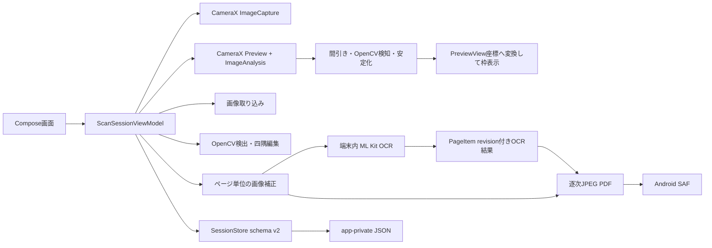

# PaperScan vNext アーキテクチャと技術判断

更新日: 2026-11-05
実装状態と検証境界は[監査記録](AUDIT.md)および[検証・リリース計画](TEST_AND_RELEASE.md)を参照。

## 現在の処理フロー

CameraXは`Preview`、`ImageCapture`、`ImageAnalysis`を同一`UseCaseGroup`とViewPortへ束ねる。解析は`STRATEGY_KEEP_ONLY_LATEST`で最新フレームを保持し、専用Executor上で250 ms間隔に制限する。検知四隅は連続3フレームの整合を見てから表示し、`ImageProxyTransformFactory`と`CoordinateTransform`で`PreviewView.outputTransform`へ移す。解析フレームは例外時もcloseし、Bitmapは解析後にrecycleする。自動シャッターは実装しない。

このCameraX処理はコードとUnit Testで確認したが、物理端末上の実カメラ、表示回転・クロップ、端末別のPreviewView変換は未確認。フレーム解析の状態テストPASSを実機座標整合PASSへ読み替えない。

公式資料: [CameraX transform output](https://developer.android.com/media/camera/camerax/transform-output)、[CoordinateTransform API](https://developer.android.com/reference/androidx/camera/view/transform/CoordinateTransform)、[ImageProxy API](https://developer.android.com/reference/androidx/camera/core/ImageProxy)、[ImageAnalysis API](https://developer.android.com/reference/androidx/camera/core/ImageAnalysis)。

## OCR: bundled ML Kit Text Recognition v2

- ML Kit Androidガイドに従い、Latin、Chinese、Japanese、Koreanを別recognizerとして同梱した。中国語recognizerは簡体字と繁体字の両方で試験した。
- bundled配布を選んだ理由は、初回モデル取得時のネットワーク依存を避けて端末内で開始できること。アプリManifestから`INTERNET`と`ACCESS_NETWORK_STATE`を除外し、OCR用の画像送信処理も持たない。
- `MlKitOcrService`は4 recognizerを順番に実行し、行単位の正規化座標を保持する。信頼度0.20未満の候補を捨て、IoU 0.85以上で同じ位置に重なる候補はモデル順の最初の行を残す。これは合成fixture上で実際に出た競合行を抑えるための暫定ルールであり、正確性を保証する言語識別器ではない。
- ページ単位の手動選択（AUTO / LATIN / CHINESE / JAPANESE / KOREAN）を保持する。AUTOは4 recognizerを実行し、明示言語では選択されたrecognizerだけを使う。選択値はOCR revisionへ含め、変更後に古い結果を再利用しない。
- エミュレータの合成fixtureでは英語、日本語、繁体字中国語、韓国語の小さな入力を認識し、簡体字中国語は複数文字を誤認識した。混在画像は重複抑制後4行になったが、簡体字を含む中国語行には誤認識が残る。結果は[検証記録](TEST_AND_RELEASE.md)参照。
- 4言語分同梱したUniversal Debug APKは、作業開始時点のDebug APKから約56.6 MiB増加した。配布端末別のAABサイズは未計測。

公式資料: [ML Kit Android Text Recognition v2](https://developers.google.com/ml-kit/vision/text-recognition/v2/android)、[対応言語](https://developers.google.com/ml-kit/vision/text-recognition/v2/languages)、[モデル配置方式](https://developers.google.com/ml-kit/tips/installation-paths)、[ML Kit利用条件](https://developers.google.com/ml-kit/terms)。ライセンス・利用条件を把握するための技術確認であり、法的評価ではない。

## 検索可能PDF: 既存JPEG writerへToUnicode文字層を追加

- Android標準`PdfDocument`は既存実装のページ画像出力に使っていたが、今回の画像品質上限とUnicode文字レイヤーを制御する小さな逐次PDF writerを追加した。ページごとに補正画像をJPEG化して書き込み、Bitmapは出力直後に解放する。
- OCR行は正規化矩形をPDF画像の配置矩形へ写し、PDF text rendering mode `3`で不可視文字として置く。コードポイントごとにUnicode UTF-16BEを対応付けたToUnicode CMapを生成する。
- `PDFBox-Android 2.0.27.0`は本体依存にせずInstrumented Testだけで使用する。PoCでPDFからの英語・日本語・簡体字・繁体字・韓国語抽出、ToUnicodeの存在、Android `PdfRenderer`上の文字不可視を確認した。
- Noto CJKのシステムTTCをPDFBoxで埋め込む試行は、CFF/OpenType形式とsubset処理の非互換に当たり、当面の実装には使わなかった。現行writerは日本語CIDフォント名を参照するがフォントファイルを埋め込まない。PDFBoxのテキスト抽出成功から、Android/iOS/デスクトップviewerでの検索・選択・コピーや見た目の互換性を推定しない。
- 現行の`Identity-H`文字コード指定とFontFileを含まないフォント辞書は互換性上の未解決事項。Adobe [PDF Reference 1.4](https://opensource.adobe.com/dc-acrobat-sdk-docs/pdfstandards/pdfreference1.4.pdf)のフォント要件を含め、埋め込み方式と実viewerでの確認が必要。
- 技術実証としてはPDFパーサー抽出がPASS。一般viewerでの手動検証を終えるまで、完全な検索可能PDF対応やRelease適格とは扱わない。

PDFBox-Androidの一次資料: [README / ライセンス](https://github.com/TomRoush/PdfBox-Android)、[リリース一覧](https://github.com/TomRoush/PdfBox-Android/releases)。

## PDF出力設定

既定はOCR ON、標準200 DPI / JPEG品質85、用紙自動、向き自動、色自動。A4/A5/Letter、縦/横、カラー/グレースケール/白黒を選べる。自動色は元画像のカラー情報を保持する。

| 画質 | DPI上限 | JPEG品質 |
|---|---:|---:|
| 高画質 | 300 | 92 |
| 標準 | 200 | 85 |
| 軽量 | 120 | 70 |

合成A4 3000×4242 pxの1ページで測った容量は、高画質330,602 bytes、標準178,679 bytes、軽量81,964 bytes。測定は出力量の比較までで、写真文書の可読性、細線・色差の保持、30ページ容量を最終決定する評価には不足している。設定変更をしても元画像は保持し、ページ画像をPDFごとに再生成する。

## 永続化・競合防止

- `ScanSession` schemaを1から2へ進め、OCR結果のstatus、revision、engine、時刻、文字列、normalized boundsを保存する。v1のJSONは新フィールドを既定値で読み込み、現行形式へ保存する。未知の未来schemaは拒否する。
- OCR revisionはpage ID、元画像識別値、EXIF、回転、ScanMode、四隅からSHA-256で作る。編集時にrevisionが変わる結果は破棄し、変更していないページ結果は再利用する。
- ページごとにOCR Jobを一つに制限する。削除・編集・PDF出力との保存競合を避け、OCR結果保存時に最新Sessionとrevisionを確認する。
- `SessionStore.saveAtomic`はMutexで同時保存要求を直列化し、保存失敗時に一時ファイルを削除する。Instrumented Testは同時要求と未知schemaで既存セッションが保たれることを確認する。プロセス強制終了や電源断時の復旧は別途未検証。
- 複数ページへScanModeを適用するときは、セッション更新を一括で保存し、選択外ページ・ページ順・手動四隅を変更しない。対象ページだけOCRを無効化して再認識する。

## 表示テーマ

システム連動を初期値にし、ライト／ダーク／システムをAndroid SharedPreferencesへ保存する。テーマ画面は現行のMaterial 3標準カラースキームを使う。色のコントラストと画面サイズ別レイアウトは実機で最終確認する。

Camera画面は`androidx.lifecycle.compose.LocalLifecycleOwner`を使う。Compose UI側にあった同プロパティは非推奨となり、Lifecycle Composeへ移動したため、Lifecycle 2.9.4の`lifecycle-runtime-compose`を依存に明示した（[公式API](https://developer.android.com/reference/kotlin/androidx/lifecycle/compose/package-summary#LocalLifecycleOwner)）。

## 次に必要な設計・検証

1. 正解四隅を持つ追加fixture・実画像を集め、検知成功率、誤検知、未検出、信頼度、旧版との差、フレーム時間を測る。現在は合成fixture1枚だけ。
2. 実機でCameraXの権限、プレビュー回転・クロップ、画面遷移、連続撮影、フレームから表示枠までを受け入れる。
3. 影・照明ムラ・反射補正は細線・数式・色の回帰fixtureと定量指標を用意して個別評価する。
4. 代表PDF viewerで各言語の検索・選択・コピーと文字位置を手動確認する。フォント未埋め込みの互換性を解決する。
5. 物理端末でAABサイズ、実文書のPDFサイズ・品質、1/10/20/30ページのメモリと時間を計測する。
